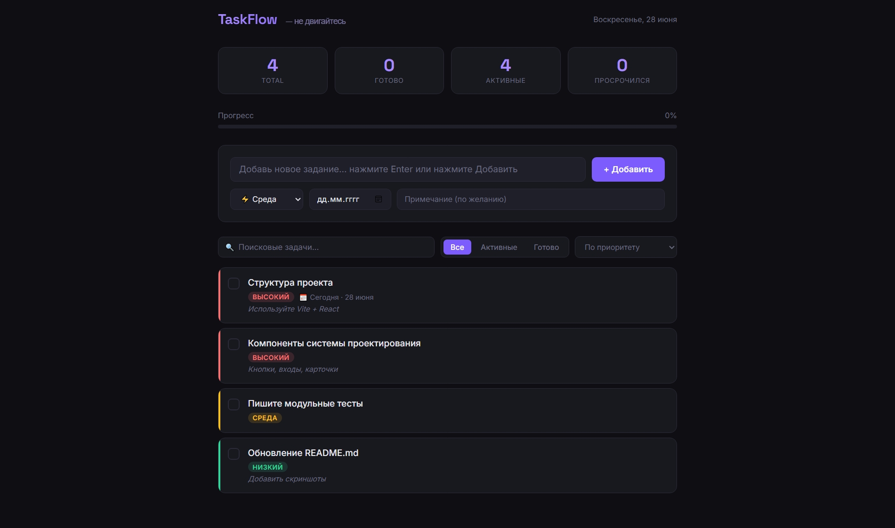

# TaskFlow — Todo App

A professional task manager web application built with vanilla HTML, CSS and JavaScript.



## 🚀 Live Demo

**[➜ Open TaskFlow](https://rossiav802-code.github.io/todo-app)**

---

## ✨ Features

- ✅ Add, edit and delete tasks
- 🔴 Priority levels — High, Medium, Low
- 📅 Deadlines with overdue detection
- 🔍 Search and filter tasks
- 📊 Progress bar and statistics
- 🖱 Drag & drop to reorder tasks
- 💾 Data saved in LocalStorage
- 📱 Fully responsive design

---

## 🛠 Tech Stack


- Pure HTML, CSS, JavaScript — no frameworks
- LocalStorage for data persistence
- Drag & Drop API
- CSS animations and transitions

---

## 📁 Project Structure

```
todo-app/
└── index.html    # Full app — HTML + CSS + JS in one file
```

---

## 🚀 How to Run

1. Clone the repository:
```bash
git clone https://github.com/rossiav802-code/todo-app.git
```
2. Open `index.html` in your browser

Or just open the **[Live Demo](https://rossiav802-code.github.io/todo-app)**

---
## CI/CD security note

The CI pipeline (build, Trivy scan, push to GHCR) initially failed because the pinned `aquasecurity/trivy-action@0.28.0` tag was removed after a supply-chain compromise of the action's tags in March 2026. The action was updated to `v0.36.0`. Lesson: pin third-party actions to a verified version (ideally a full commit SHA) and review security advisories when a pinned dependency disappears.


## 👤 Author

- GitHub: [@rossiav802-code](https://github.com/rossiav802-code)
- Email: rossiav802@gmail.com
